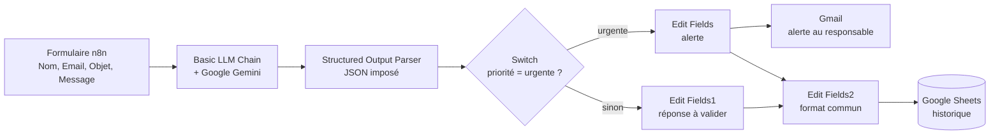

# Assistant IA de traitement des demandes clients (n8n + Gemini)

Prototype d'automatisation réalisé avec **n8n** et **Google Gemini** pour aider le service client d'une PME e-commerce : chaque demande envoyée par formulaire est **analysée par l'IA**, **classée** (catégorie + priorité), reçoit une **proposition de réponse**, puis est **routée** selon son urgence et **enregistrée** dans Google Sheets.

> ⚠️ L'IA produit une **proposition**, jamais une décision : aucune réponse n'est envoyée au client sans validation humaine.
> Toutes les données utilisées dans ce projet sont **fictives** (adresses `@example.com`).

Mini-projet réalisé à l'IPSA (Bachelor 2) — Shain Kourtni.


---

## Fonctionnement



| Étape | Nœud n8n | Rôle |
|---|---|---|
| 1 | **On form submission** | Le client saisit sa demande (4 champs obligatoires) |
| 2 | **Basic LLM Chain + Gemini** | Prompt dynamique : l'IA analyse la demande |
| 3 | **Structured Output Parser** | Impose un JSON : `categorie`, `priorite`, `resume`, `reponse`, `informations_manquantes` |
| 4 | **Switch** | Priorité `urgente` → alerte ; sinon → « Réponse à valider » |
| 5 | **Gmail** | Envoie l'alerte (résumé + proposition de réponse) au responsable |
| 6 | **Google Sheets** | Enregistre date, nom, email, message, catégorie, priorité, réponse, statut |

---

## Captures

| Formulaire | Analyse par l'IA |
|---|---|
|  |  |

| Format JSON imposé | Routage (Switch) |
|---|---|
|  |  |

**Email d'alerte reçu par le responsable (demande urgente)**


**Historique des demandes dans Google Sheets**


---

## Prompt utilisé

```text
Tu es un assistant du service client. Analyse la demande ci-dessous et renvoie une analyse structurée.

Règles strictes :
- Tu produis une PROPOSITION de réponse soumise à validation humaine. Tu ne décides rien.
- Tu n'annonces jamais un remboursement accordé, un geste commercial, une date de livraison,
  un délai chiffré ni une action déjà réalisée.
- Tu n'inventes aucune information absente du message : ni numéro de commande, ni montant,
  ni date, ni transporteur.
- Si une information essentielle manque, signale-le dans le résumé et demande-la dans la réponse.
- Catégorie strictement parmi : livraison, remboursement, reclamation, information, autre.
- Priorité strictement parmi : faible, normale, urgente.
- Réponse rédigée en français, ton professionnel et courtois, 4 à 8 lignes, signée "Le service client".

Demande à analyser :
Nom : {{ $json.Nom }}
Email : {{ $json.Email }}
Objet : {{ $json.Objet }}
Message : {{ $json.Message }}
Date de soumission : {{ $json.submittedAt }}
```

**Pourquoi ce prompt ?** Une première version, plus simple, laissait l'IA libre : elle pouvait inventer une date ou promettre un remboursement. Les règles ajoutées l'empêchent d'inventer, imposent des catégories fixes (indispensable pour le Switch) et l'obligent à demander les informations manquantes.

---

## Tests

| Test | Demande (fictive) | Catégorie | Priorité | Branche | Résultat |
|---|---|---|---|---|---|
| Normale | Livrez-vous en Belgique ? | livraison | faible | Réponse à valider | ✅ |
| Urgente | Colis non reçu, besoin pour samedi | livraison | urgente | Alerte responsable | ✅ |
| Ambiguë | « Le produit ne va pas du tout » | reclamation | normale | Réponse à valider | ✅ |
| Incomplète | « Remboursement » | remboursement | normale | Réponse à valider | ✅ |
| Hors catégorie | Recrutez-vous des stagiaires ? | information | faible | Réponse à valider | ⚠️ attendu « autre » |

Dans tous les cas, l'IA n'a inventé aucune date ni aucun remboursement, et a demandé le numéro de commande quand il manquait.

---

## Installer le workflow

1. Dans n8n : **nouveau workflow → ⋯ → Import from File** et choisir [`workflow/assistant-demandes-clients.json`](workflow/assistant-demandes-clients.json).
2. Créer vos propres identifiants (non inclus dans le fichier) :
   - **Google Gemini** : clé API Google AI Studio ;
   - **Gmail** et **Google Sheets** : client OAuth dans Google Cloud Console, avec l'URI de redirection affichée par n8n.
3. Dans le nœud **Edit Fields**, remplacer `responsable@example.com` par l'adresse du responsable.
4. Dans **Append row in sheet**, choisir votre Google Sheet. Ses colonnes doivent s'appeler :
   `date | nom | email | message | categorie | priorite | reponse | statut`
5. Cliquer sur **Execute workflow** et remplir le formulaire.

---

## Limites et améliorations

- Le quota gratuit de Gemini peut bloquer le workflow (*too many requests*) → activer **Retry On Fail**.
- L'IA ne respecte pas toujours le prompt (test hors catégorie) → préciser les catégories avec des exemples.

---

## Contenu du dépôt

```
├── README.md
├── workflow/
│   └── assistant-demandes-clients.json   # workflow n8n (sans identifiants)
└── docs/
    ├── rapport-technique.pdf             # rapport complet du projet
    └── captures/                         # captures d'écran
```

Les informations personnelles (adresse email, identifiants Google, ID du Google Sheet) ont été retirées ou floutées.
